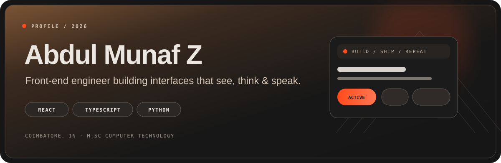
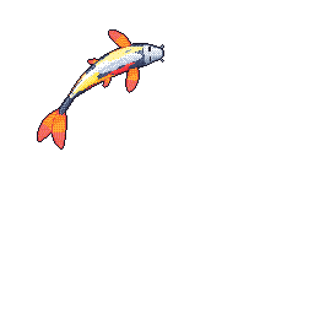

  

My koi evolves with my public GitHub activity.

  
  
  
  
  

 

<picture>
  <source media="(prefers-color-scheme: dark)" srcset="https://raw.githubusercontent.com/ABDULMUNAFZ/ABDULMUNAFZ/output/calendar-3d-dark.svg" />
  <source media="(prefers-color-scheme: light)" srcset="https://raw.githubusercontent.com/ABDULMUNAFZ/ABDULMUNAFZ/output/calendar-3d-light.svg" />
  
</picture>

<strong>Contribution calendar.</strong> Taller and brighter blocks mark busier days. This section refreshes from live GitHub data every 12 hours.

 

<picture>
  <source media="(prefers-color-scheme: dark)" srcset="https://raw.githubusercontent.com/ABDULMUNAFZ/ABDULMUNAFZ/output/about-dark.svg" />
  <source media="(prefers-color-scheme: light)" srcset="https://raw.githubusercontent.com/ABDULMUNAFZ/ABDULMUNAFZ/output/about-light.svg" />
  
</picture>

<strong>Abdul Munaf Z — front-end engineer &amp; ML builder</strong>
<ul><li><code>based_in</code> — Coimbatore, Tamil Nadu <em>(India · IST (UTC+5:30))</em></li><li><code>studying</code> — M.Sc. Computer Technology <em>(Sri Krishna Arts &amp; Science College)</em></li><li><code>previously</code> — B.Sc. AI &amp; Machine Learning <em>(Rathinam College)</em></li><li><code>works_with</code> — React · TypeScript · Python · PyTorch <em>(plus OpenCV for real-time vision)</em></li><li><code>building</code> — AI-powered full-stack web apps <em>(real-time ML in the browser loop)</em></li><li><code>talk_to_me</code> — front-end, computer vision, hackathons <em>(z.abdulmunaf@gmail.com)</em></li><li><code>speaks</code> — English · Tamil · Hindi · Urdu <em>(Urdu: spoken only)</em></li></ul>

 

<picture>
  <source media="(prefers-color-scheme: dark)" srcset="https://raw.githubusercontent.com/ABDULMUNAFZ/ABDULMUNAFZ/output/hackathons-dark.svg" />
  <source media="(prefers-color-scheme: light)" srcset="https://raw.githubusercontent.com/ABDULMUNAFZ/ABDULMUNAFZ/output/hackathons-light.svg" />
  
</picture>

<ul><li><strong>2ND</strong> · New India Vibrant Hackathon — Urban Governance — Surat Municipal Corporation (2023)</li><li><strong>1ST</strong> · HACKSTRONAUTS 24-hr Challenge — Exadata Club — SRM University, Chennai (2025)</li><li><strong>1ST</strong> · Mealzy — Innovative Food Web Solutions — AIC Raise, Coimbatore (2025)</li><li><strong>3RD</strong> · Indian Sign Language Detection System — Sri Krishna College of Engineering (2026)</li><li><strong>TOP 8</strong> · Bitathon — SAS Analytics Model Pitch — Goa Institute of Management (2026)</li></ul>

 

<picture>
  <source media="(prefers-color-scheme: dark)" srcset="https://raw.githubusercontent.com/ABDULMUNAFZ/ABDULMUNAFZ/output/work-dark.svg" />
  <source media="(prefers-color-scheme: light)" srcset="https://raw.githubusercontent.com/ABDULMUNAFZ/ABDULMUNAFZ/output/work-light.svg" />
  
</picture>

<ul><li><strong>FloodGuard</strong> — Hyperlocal flash-flood prediction, risk and rescue for Wayanad, Kerala: a 3D command map for responders and a citizen PWA. Smart India Hackathon 2026. <code>React · TypeScript · FastAPI · PostGIS · XGBoost</code></li><li><strong>Knowra</strong> — Evidence-first knowledge assistant: hybrid pgvector + BM25 search with reranking, every answer traced to a cited source passage. <code>React · TypeScript · pgvector · Supabase</code></li><li><strong>Full-Stack Chat + Sentiment AI</strong> — Real-time chat with image sharing and live sentiment analysis, stored securely in MongoDB Atlas. <code>React · Node · MongoDB · NLP</code></li><li><strong>GreenSight AI</strong> — Deep-learning pipeline that classifies off-road terrain into 10 environmental classes in real time. <code>Python · YOLOv8 · PyTorch</code></li><li><strong>Indian Sign Language Recognition</strong> — Continuous sentence formation from signs with multi-language text-to-speech, built accessibility-first. <code>OpenCV · PyTorch · Python</code></li></ul>

 

<picture>
  <source media="(prefers-color-scheme: dark)" srcset="https://raw.githubusercontent.com/ABDULMUNAFZ/ABDULMUNAFZ/output/stack-dark.svg" />
  <source media="(prefers-color-scheme: light)" srcset="https://raw.githubusercontent.com/ABDULMUNAFZ/ABDULMUNAFZ/output/stack-light.svg" />
  
</picture>

<ul><li><strong>Front-end</strong> — React · TypeScript · JavaScript · Three.js · HTML5 · CSS3 · Webflow</li><li><strong>Back-end &amp; cloud</strong> — Python · Node.js · Flask · MongoDB · Netlify · Hostinger</li><li><strong>AI / ML</strong> — PyTorch · TensorFlow · OpenCV · YOLOv8 · Twilio</li><li><strong>Tools</strong> — Git · Bitbucket · PyCharm · WordPress · LaTeX · Adobe CC</li></ul>

 

<picture>
  <source media="(prefers-color-scheme: dark)" srcset="https://raw.githubusercontent.com/ABDULMUNAFZ/ABDULMUNAFZ/output/certifications-dark.svg" />
  <source media="(prefers-color-scheme: light)" srcset="https://raw.githubusercontent.com/ABDULMUNAFZ/ABDULMUNAFZ/output/certifications-light.svg" />
  
</picture>

<ul><li><strong>Google</strong> — Professional</li><li><strong>Oracle</strong> — Cloud</li><li><strong>Git</strong> — Version control</li><li><strong>OPSWAT</strong> — Cybersecurity</li><li><strong>RapidMiner</strong> — Data science</li><li><strong>Forage</strong> — Job simulation</li><li><strong>Great Learning</strong> — Upskilling</li></ul>

 

<picture>
  <source media="(prefers-color-scheme: dark)" srcset="https://raw.githubusercontent.com/ABDULMUNAFZ/ABDULMUNAFZ/output/languages-dark.svg" />
  <source media="(prefers-color-scheme: light)" srcset="https://raw.githubusercontent.com/ABDULMUNAFZ/ABDULMUNAFZ/output/languages-light.svg" />
  
</picture>

<strong>Languages &amp; numbers.</strong> The visual is refreshed every 12 hours from public GitHub data, including code share and profile activity.

 

<picture>
  <source media="(prefers-color-scheme: dark)" srcset="https://raw.githubusercontent.com/ABDULMUNAFZ/ABDULMUNAFZ/output/snake-dark.svg" />
  <source media="(prefers-color-scheme: light)" srcset="https://raw.githubusercontent.com/ABDULMUNAFZ/ABDULMUNAFZ/output/snake.svg" />
  
</picture>

Every graphic here is generated by <a href="./scripts"><code>scripts/</code></a> from <a href="./data/profile.json"><code>data/profile.json</code></a> and live GitHub data, refreshed every 12 hours.

